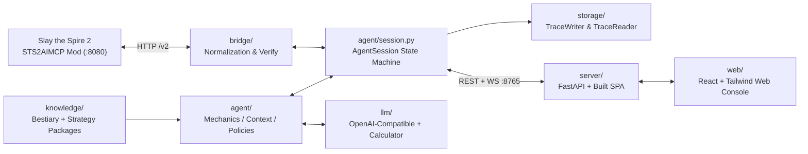

# SpireMind

[English](README.md) | [简体中文](README.zh-CN.md)

[](https://github.com/optima-xu/SpireMind/actions/workflows/test.yml)
[](https://www.python.org/)
[](LICENSE)

**A clean, inspectable, open-source AI agent for Slay the Spire 2 — complete with a local Web Console.**

SpireMind combines **deterministic combat rules & bounded state search**, **LLM strategic reasoning**, and a **real-time React Web Console**. You can start or attach to a run in one click, inspect hand risks, enemy intents, calculations, and AI reasoning live, or step back through any recorded run frame by frame.

---

## Highlights

- **Real-Time Web Console (FastAPI + WebSocket + React)**
  - **Cockpit**: Live HP/Gold/Potions/Relics/Deck inspector, combat hand highlights (`unplayable` and deterministic `self_lethal` risk warnings), enemy intents, AI reasoning, arithmetic calculations, `RunContext`, and collapsible `combat_assessment`; one-click **Start Run**, **Attach**, **Step Once**, **Pause / Resume**, **Stop**, and **Observe**.
  - **Replay**: Browse recorded attempts in `runs/` (supporting both unified `steps.jsonl` and legacy `states.jsonl + decisions.jsonl`) with range scrubber, `← / →` hotkeys, and scene filter chips.
  - **Settings & Doctor**: One-click presets (`DeepSeek`, `OpenAI`, `Ollama`), masked API key management saved locally to `config.local.toml` / `.env`, and live **Bridge Probe** + **LLM API Probe**.
- **Deterministic Guards + LLM Strategist**
  - Bounded survival/lethal search handles provable combat sequences (lethal lines, survival lines, self-lethal filtering, forced ordering) deterministically.
  - The model selects strictly from legal `action_id` candidates offered by the bridge, backed by transition verification and crash-safe action journaling.
- **Clean 8-Module Acyclic Backend Architecture**
  - Strictly layered package DAG (`config -> domain -> {bridge, llm, knowledge} -> agent -> storage -> server -> cli`) enforced by architecture tests.

---

## Architecture Overview



See [docs/ARCHITECTURE.md](docs/ARCHITECTURE.md) for module boundaries and execution details.

---

## Quick Start (Windows Live Play)

> Live bridge targets **Windows + Slay the Spire 2 v0.111.0 (standard single-player)**. Backend and Web Console development/tests run on Windows and Linux.

### 1. Install Dependencies & Build Web UI

**Close the game first**, then run in PowerShell:

```powershell
git clone https://github.com/optima-xu/SpireMind.git
Set-Location SpireMind
powershell -NoProfile -ExecutionPolicy Bypass -File scripts/setup.ps1
```

Setup automatically:
1. Installs `uv` if missing and syncs locked Python dependencies into `.venv`;
2. Copies `.env.example` -> `.env` and `config.example.toml` -> `config.local.toml` without overwriting existing files;
3. Runs `pnpm --dir web install` and `pnpm --dir web run build` when `pnpm` is available;
4. Installs the pinned `STS2AIMCP` bridge mod unless `-Offline` is passed.

### 2. Launch the Web Console

Start **Slay the Spire 2** via Steam with **STS2AIMCP** enabled, then run:

```powershell
.\spiremind.cmd
```

This starts the server on `http://127.0.0.1:8765` and opens your browser:
1. Open **Settings & Doctor**, choose a preset or enter your API key, and click **Save Settings**;
2. Click **Test Game Bridge** and **Test LLM API**;
3. Switch to **Cockpit** and click **Start New Run** or **Attach Run**.

---

## CLI Reference

`spiremind` exposes three commands (`ui` is the default when invoked without a subcommand):

| Command | Purpose | Example |
| --- | --- | --- |
| `spiremind ui` (default) | Launch FastAPI + Web Console | `.\spiremind.cmd ui --port 8765 --no-browser` |
| `spiremind play` | Run the agent headlessly in the terminal | `.\spiremind.cmd play --character ironclad --ascension 0 --policy model` |
| `spiremind doctor` | Check config, game bridge, and optional LLM probe | `.\spiremind.cmd doctor --check-llm` |

To run purely with deterministic rules (zero LLM calls):

```powershell
.\spiremind.cmd play --attach --policy rules
```

---

## Repository Structure

```text
SpireMind/
├── src/spiremind/
│   ├── config.py              # TOML / .env settings, presets & redacted save
│   ├── domain/                # Immutable GameState, Action, and safety guards
│   ├── knowledge/             # v0.111.0 enemies & 15 character strategy packages
│   ├── bridge/                # STS2AIMCP HTTP client, normalization & probes
│   ├── llm/                   # OpenAI-compatible client & arithmetic tool loop
│   ├── storage/               # Unified JSONL TraceWriter / TraceReader (V2 + V1)
│   ├── agent/                 # Combat search, DeckAnalyzer, RunTracker, policies & session
│   ├── server/                # FastAPI REST, WebSocket & SPA hosting
│   └── cli.py                 # ui / play / doctor entrypoint
├── web/                       # React + TypeScript + Vite + Tailwind Web Console
├── tests/                     # Offline pytest suite & DAG architecture checks
├── docs/                      # Architecture & deployment guides
└── scripts/                   # setup.ps1 and prepare-bridge.ps1
```

For manual installation and troubleshooting, see [docs/DEPLOYMENT.md](docs/DEPLOYMENT.md).
