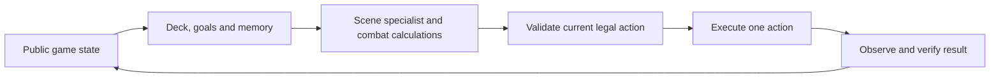

# SpireMind

[English](README.md) | [简体中文](README.zh-CN.md)

[](https://github.com/optima-xu/SpireMind/actions/workflows/test.yml)
[](https://www.python.org/)
[](LICENSE)

**An autonomous player for Slay the Spire 2, with decisions you can inspect.**

SpireMind handles combat, card rewards, shops, routes, rest sites and events. It combines a language model with combat calculations, character strategies and memory of earlier decisions. The same run goals follow it from one room to the next: what the deck lacks, how much health to preserve, and when to spend a potion.

You can let it play, pause to take over, then resume. Each attempt leaves a record of the state it saw, the action it chose and the result it observed. That makes the project useful both for watching an agent play and for investigating why a decision worked or failed.

## What it does

- **Connects decisions across a run.** Combat, Run, Map and Event specialists share deck analysis, boss preparation goals and recent combat results. A scene router selects the relevant specialist for each decision.
- **Calculates supported combat sequences.** Local rules and bounded search check damage, block, energy, health costs and action order. The model receives these facts alongside the current legal actions. Unsupported effects remain explicit unknowns.
- **Reuses experience with conditions.** Verified transitions can become local experience. A candidate lesson must pass evidence checks before activation, and retrieval checks whether it fits the current state. This updates a local memory database; model weights stay unchanged.
- **Recovers interrupted execution.** Pending actions are saved before submission. After a restart, the runtime checks their outcome before continuing, reducing the risk of repeating an action whose response was lost.
- **Makes behavior inspectable.** Traces contain game states, decision context, explanations, actions and verification results. Offline tools summarize attempts, check labeled decisions and measure preparation costs.

## Deploy on Windows

Live play targets **Slay the Spire 2 v0.111.0, standard single-player mode**. You need an installed Steam copy and [Git for Windows](https://git-scm.com/downloads/win). The setup script installs the Python environment and the pinned [STS2AIMCP](https://github.com/BMingSY/sts2-ai-mcp) game bridge.

Ironclad at Ascension 0 has the most live validation. Strategy packages also cover Silent, Regent, Necrobinder and Defect; their live performance is less tested. Multiplayer, custom runs and other game versions are outside the current validated scope. The game keeps modded saves separate from vanilla saves.

### 1. Install

**Close the game**, open PowerShell, and run:

```powershell
git clone https://github.com/optima-xu/SpireMind.git
Set-Location SpireMind
powershell -NoProfile -ExecutionPolicy Bypass -File scripts/setup.ps1
```

Setup finds the Steam game directory, prepares Python 3.13 and locked dependencies, builds and installs the bridge, and creates `.env` and `config.local.toml`. It obtains missing uv and .NET 9 SDK installations through their official installers. Existing configuration files are preserved. Installation requires internet access.

If automatic game detection fails, supply the directory:

```powershell
powershell -NoProfile -ExecutionPolicy Bypass -File scripts/setup.ps1 -GameRoot 'D:\SteamLibrary\steamapps\common\Slay the Spire 2'
```

### 2. Configure DeepSeek

Open `.env` in the project directory and fill in your key:

```dotenv
deepseek_api_key=replace_with_your_deepseek_key
```

The generated `config.local.toml` contains these model settings:

```toml
[model]
base_url = "https://api.deepseek.com"
model = "deepseek-flash"
api_key_env = "deepseek_api_key"

[model.extra_body]
thinking = { type = "disabled" }
```

When upgrading an existing checkout, update these settings yourself because setup preserves your local files. Keep credentials in `.env` or environment variables. The CLI loads the files automatically; an existing process environment variable takes precedence over `.env`.

The model adapter supports compatible Chat Completions endpoints. The default policy requires JSON decisions and function tools. See the [deployment guide](docs/DEPLOYMENT.md) for configuration details.

### 3. Start a run

Launch the game through Steam, enable **STS2AIMCP**, and leave it at the **main menu**. Run these commands from the project directory:

```powershell
.\spiremind.cmd doctor
.\spiremind.cmd start --character ironclad --ascension 0
```

`doctor` checks the game bridge without calling the model. `start` begins live play and **makes model API requests**. Keep this terminal open while the agent runs.

Available character names are `ironclad`, `silent`, `regent`, `necrobinder` and `defect`. The requested difficulty must be unlocked in the game. If a saved run exists, use `resume`, or finish or abandon that run in the game before starting another.

### 4. Pause, inspect and resume

Open another PowerShell window in the same project directory:

| Command | Purpose |
| --- | --- |
| `.\spiremind.cmd pause` | Request a pause after any pending action has been checked. |
| `.\spiremind.cmd status` | Read the current phase and control status. |
| `.\spiremind.cmd resume` | Continue a paused agent, or reconnect to an unfinished game after the process stopped. |
| `Ctrl+C` in the agent terminal | Stop the process while preserving logs and pending-action records. |

Wait until `status` reports `paused` before playing manually. On resume, the agent reads the current state and makes a fresh decision.

## Try it without a game or API key

After cloning the repository, run:

```powershell
powershell -NoProfile -ExecutionPolicy Bypass -File scripts/setup.ps1 -Offline
.\spiremind.cmd start --environment mock --policy rules
.\spiremind.cmd evaluate --output runs/quality/latest.json
.\spiremind.cmd benchmark --rounds 3 --output runs/benchmarks/local.json
```

`-Offline` skips game detection and bridge installation; dependency downloads still need internet access. The three commands after setup make no game or model requests:

| Command | What it checks |
| --- | --- |
| `start --environment mock --policy rules` | A fixed ten-action walkthrough of the runtime. |
| `evaluate` | Eight labeled policy cases, including combat and reward decisions. |
| `benchmark` | Preparation time and context size across fixed states. |

These checks help catch implementation errors. The mock walkthrough does not simulate a full game, and benchmark timing does not measure win rate.

## How decisions become actions



Even when a search finds a multi-step sequence, the runtime submits one action and replans from the resulting state. It checks action bindings before execution and records whether the observed transition and supported effects match expectations.

The code separates responsibilities: `core/` defines state and contracts; `decision/` chooses actions; `application/` coordinates execution and recovery; `adapters/` connects the game, model and storage; `learning/` manages experience; `evaluation/` runs offline checks. See the [current architecture](docs/ARCHITECTURE.md) for the full flow and dependency boundaries.

## Inspect results and develop

Each attempt writes to `runs/<attempt-id>/`. Start with `summary.json`, then inspect the state and decision logs. To summarize an existing attempt without sending game actions:

```powershell
.\spiremind.cmd replay runs/<attempt-id>
```

Replace `<attempt-id>` with an actual directory name. Full command options, memory inspection and custom configuration are documented in the [command reference](docs/COMMANDS.md).

For development:

```powershell
uv sync --locked
uv run pytest -q
uv run ruff check src tests scripts
uv run ruff format --check src tests scripts
```

The 2026-10-30 refactor passed local tests, labeled policy checks and an isolated package-installation check. It still needs a fresh live run with the new model configuration; improved win rate has not been established. Combat calculations cover a defined subset of mechanics, and complete offensive search is currently limited to supported states with one living enemy. See [validation history](docs/ACCEPTANCE.md) for earlier live results and [performance reproduction](docs/PERFORMANCE.md) for historical measurements.

Contributions are welcome; see [CONTRIBUTING.md](CONTRIBUTING.md). SpireMind code is licensed under [MIT](LICENSE). Game assets and third-party components have their own terms, listed in [third-party notices](THIRD_PARTY_NOTICES.md).
