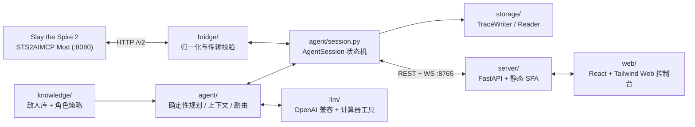

# SpireMind

[简体中文](README.zh-CN.md) | [English](README.md)

[](https://github.com/optima-xu/SpireMind/actions/workflows/test.yml)
[](https://www.python.org/)
[](LICENSE)

**一个简洁、可观测、架构清晰的《杀戮尖塔 2》（Slay the Spire 2）本地 AI Agent，自带实时 Web 控制台。**

SpireMind 将**确定性战斗规则与有界搜索**、**大语言模型战略决策**以及**本地可观测 Web 控制台**结合在一起：你可以一键启动或接管一局游戏，实时查看每一步的手牌、敌人意图、风险拦截、AI 推理依据和算术校验结果，也可以在事后逐帧回放整局录像。

---

## 核心特性

- **实时 Web 控制台（FastAPI + WebSocket + React）**
  - **实时控制台 (`Cockpit`)**：可视化展示生命/金币/遗物/药水/完整牌组、战斗手牌（标注不可出与自伤致死风险 `self_lethal`）、敌人意图与状态、AI 决策理由、算术计算详情、策略上下文及可展开的确定性评估面板；支持随时**开新局、接管对局、单步执行、暂停/恢复、停止**。
  - **历史回放 (`Replay`)**：浏览 `runs/` 下的历史对局（同时兼容新版 `steps.jsonl` 与旧版 `states.jsonl + decisions.jsonl`），支持进度条拖拽、`← / →` 快捷键步进与场景过滤。
  - **设置与诊断 (`Settings & Doctor`)**：内置 DeepSeek / OpenAI / Ollama 一键预设；可视化修改模型与运行参数并写入本地 `config.local.toml` / `.env`（密钥脱敏展示）；内置 **游戏桥接探测** 与 **LLM API 探测**。
- **确定性安全护栏 + LLM 混合决策**
  - 在可验证的机制范围内优先使用局部规则与有界状态搜索（斩杀线、生存线、致死自伤过滤、强制效果顺序）。
  - 模型仅允许从桥接返回的合法 `action_id` 中选择，配合状态转移校验与中断恢复日志，不越权、不猜测隐藏抽牌顺序。
- **极简单向依赖架构（8 个核心模块）**
  - 彻底移除过度复杂与分散的胶水层，代码按严格单向 DAG 分层，职责一目了然。

---

## 系统架构



完整设计细节请参阅 [架构说明 (docs/ARCHITECTURE.md)](docs/ARCHITECTURE.md)。

---

## 快速开始（Windows 实机）

> 实机桥接当前适配 **Windows +《杀戮尖塔 2》v0.111.0（标准单人模式）**。Python 与 Web 控制台测试可在 Windows / Linux 运行。

### 1. 安装依赖与构建前端

**先关闭游戏**，在项目根目录执行一键安装脚本：

```powershell
git clone https://github.com/optima-xu/SpireMind.git
Set-Location SpireMind
powershell -NoProfile -ExecutionPolicy Bypass -File scripts/setup.ps1
```

安装脚本会自动：
1. 检查/安装 `uv` 并创建锁定的 Python 虚拟环境；
2. 若未存在 `config.local.toml` 和 `.env`，从示例模板复制生成（已有配置不会覆盖）；
3. 若本机已安装 `pnpm`，自动执行 `pnpm --dir web install` 与 `pnpm --dir web run build` 构建前端静态产物 `web/dist/`；
4. 若未加 `-Offline`，检查 .NET 9 SDK 并构建安装 pinned `STS2AIMCP` 游戏桥接模组。

### 2. 启动 Web 控制台

从 Steam 启动《杀戮尖塔 2》并启用 **STS2AIMCP** 模组，然后运行：

```powershell
.\spiremind.cmd
```

程序将在 `http://127.0.0.1:8765` 启动本地控制台并自动打开浏览器：
1. 打开 **设置与诊断 (Settings & Doctor)**，选择模型预设并填写 API Key，点击 **保存配置**；
2. 分别点击 **检测游戏桥接** 与 **测试 LLM API** 确认绿灯；
3. 切回 **实时控制台 (Cockpit)**，点击 **开新局** 或 **接管当前对局**。

---

## CLI 命令一览

`spiremind` 提供三个简洁的子命令（默认进入 `ui`）：

| 命令 | 说明 | 示例 |
| --- | --- | --- |
| `spiremind ui`（默认） | 启动 FastAPI + Web 控制台服务 | `.\spiremind.cmd ui --port 8765 --no-browser` |
| `spiremind play` | 在终端无界面运行一局 Agent | `.\spiremind.cmd play --character ironclad --ascension 0 --policy model` |
| `spiremind doctor` | 诊断本地配置、游戏桥接与模型连通性 | `.\spiremind.cmd doctor --check-llm` |

纯确定性规则试跑（不调用 LLM API）：

```powershell
.\spiremind.cmd play --attach --policy rules
```

---

## 目录结构

```text
SpireMind/
├── src/spiremind/
│   ├── config.py              # TOML / .env 配置、预设与脱敏保存
│   ├── domain/                # 不可变状态、动作 Schema 与安全校验
│   ├── knowledge/             # v0.111.0 敌人知识与角色策略包
│   ├── bridge/                # STS2AIMCP HTTP 客户端、协议归一化与探测
│   ├── llm/                   # OpenAI 兼容客户端与确定性计算器工具
│   ├── storage/               # 统一轨迹读写 (steps.jsonl + V1 兼容)
│   ├── agent/                 # 战斗搜索、牌组分析、RunTracker、策略与 Session
│   ├── server/                # FastAPI REST、WebSocket 与 SPA 托管
│   └── cli.py                 # ui / play / doctor 入口
├── web/                       # React + TypeScript + Vite + Tailwind Web 控制台
├── tests/                     # 离线完整单元测试与架构边界测试
├── docs/                      # 架构文档与部署文档
└── scripts/                   # setup.ps1 与桥接构建脚本
```

更多环境准备与排错说明请查看 [部署指南 (docs/DEPLOYMENT.md)](docs/DEPLOYMENT.md)。
