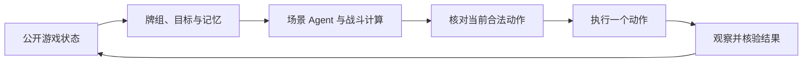

# SpireMind

[English](README.md) | [简体中文](README.zh-CN.md)

[](https://github.com/optima-xu/SpireMind/actions/workflows/test.yml)
[](https://www.python.org/)
[](LICENSE)

**一个会自主游玩《杀戮尖塔 2》、并留下决策记录的 Agent。**

SpireMind 可以处理战斗、选牌、商店、路线、休息点和事件。它结合语言模型、战斗计算、角色策略和历史经验，让不同场景的决策围绕同一局游戏展开：牌组还缺什么、需要保留多少生命、什么时候值得使用药水。

你可以让它连续游玩，暂停后自己接手，再交还给 Agent。每次运行都会记录它看到了什么、选择了什么，以及游戏实际发生了什么，方便观察它的表现，也方便追查一次判断为什么有效或失败。

## 能做什么

- **让整局决策保持联系。** Combat、Run、Map、Event 四类专业 Agent 共享牌组分析、Boss 准备目标和近期战斗结果，由路由器为当前场景选择对应的决策者。
- **计算可确认的战斗结果。** 本地规则和有限搜索核算伤害、格挡、能量、生命成本与出牌顺序，再把计算结果和当前合法动作交给模型。未覆盖的效果会明确标为未知。
- **有条件地复用经验。** 经过核验的状态转移可以进入本地经验库；候选经验通过证据检查后才能启用，使用时还会检查当前局面是否适用。学习发生在本地记忆中，模型权重保持不变。
- **恢复中断的对局。** 动作提交前先保存待处理记录。进程重启后先核对执行结果，再继续决策，降低因响应丢失而重复操作的风险。
- **检查决策过程。** 日志保留游戏状态、决策上下文、选择理由、动作及核验结果；离线工具可以汇总历史记录、检查标注局面，并测量决策准备开销。

## 在 Windows 上部署

实机适配范围是 **《杀戮尖塔 2》v0.111.0、标准单人模式**。需要已安装的 Steam 游戏和 [Git for Windows](https://git-scm.com/downloads/win)。安装脚本会准备 Python 环境，并安装固定版本的 [STS2AIMCP](https://github.com/BMingSY/sts2-ai-mcp) 游戏桥接模组。

铁甲战士进阶 0 的实机验证最多。Silent、Regent、Necrobinder 和 Defect 也有策略包，但实战验证较少。多人、自定义模式和其他游戏版本尚未纳入当前验证范围。游戏的模组存档与原版存档分开保存。

### 1. 安装

**先关闭游戏**，打开 PowerShell，执行：

```powershell
git clone https://github.com/optima-xu/SpireMind.git
Set-Location SpireMind
powershell -NoProfile -ExecutionPolicy Bypass -File scripts/setup.ps1
```

脚本会查找 Steam 游戏目录，准备 Python 3.13 和锁定版本的依赖，构建并安装桥接模组，创建 `.env` 与 `config.local.toml`。缺少 uv 或 .NET 9 SDK 时，会通过官方安装器补齐。已有配置文件会保留。安装过程需要联网。

如果没有找到游戏，手动指定目录：

```powershell
powershell -NoProfile -ExecutionPolicy Bypass -File scripts/setup.ps1 -GameRoot 'D:\SteamLibrary\steamapps\common\Slay the Spire 2'
```

### 2. 配置 DeepSeek

打开项目目录中的 `.env`，填入自己的密钥：

```dotenv
deepseek_api_key=replace_with_your_deepseek_key
```

生成的 `config.local.toml` 包含以下模型配置：

```toml
[model]
base_url = "https://api.deepseek.com"
model = "deepseek-flash"
api_key_env = "deepseek_api_key"

[model.extra_body]
thinking = { type = "disabled" }
```

从旧版本升级时，请手动更新这些设置；安装脚本会保留原有本地配置。密钥放在 `.env` 或环境变量中。命令行会自动读取配置文件；进程中已有的同名环境变量优先于 `.env`。

模型接口支持兼容 Chat Completions 的服务。默认策略需要 JSON 输出和函数工具支持。完整配置说明见[部署指南](docs/DEPLOYMENT.md)。

### 3. 开始一局

通过 Steam 启动游戏，启用 **STS2AIMCP** 模组，停留在**主菜单**。在项目目录执行：

```powershell
.\spiremind.cmd doctor
.\spiremind.cmd start --character ironclad --ascension 0
```

`doctor` 检查游戏桥接，不调用模型。`start` 开始实机游玩，**会调用模型 API 并消耗用量**。游玩期间保持这个终端开启。

角色参数可选 `ironclad`、`silent`、`regent`、`necrobinder`、`defect`；进阶等级需要已在游戏中解锁。如果已有未完成的对局，使用 `resume` 继续，或先在游戏内结束、放弃该局，再开始新局。

### 4. 暂停、查看与继续

在同一项目目录打开另一个 PowerShell 窗口：

| 命令 | 用途 |
| --- | --- |
| `.\spiremind.cmd pause` | 请求暂停，等待正在处理的动作完成核对。 |
| `.\spiremind.cmd status` | 查看当前阶段和控制状态。 |
| `.\spiremind.cmd resume` | 继续已暂停的 Agent，或在进程停止后重新连接未完成对局。 |
| 在 Agent 终端按 `Ctrl+C` | 停止进程，保留日志和待处理动作记录。 |

等到 `status` 显示 `paused` 后再手动操作游戏。恢复时，Agent 会重新读取当前状态并作出新的判断。

## 不用游戏和 API Key 也能体验

克隆仓库后，在项目目录执行：

```powershell
powershell -NoProfile -ExecutionPolicy Bypass -File scripts/setup.ps1 -Offline
.\spiremind.cmd start --environment mock --policy rules
.\spiremind.cmd evaluate --output runs/quality/latest.json
.\spiremind.cmd benchmark --rounds 3 --output runs/benchmarks/local.json
```

`-Offline` 跳过游戏检测和桥接安装，首次下载依赖仍需要网络。安装之后的三个命令都不会请求游戏或模型：

| 命令 | 检查内容 |
| --- | --- |
| `start --environment mock --policy rules` | 用固定的十步动作走通运行流程。 |
| `evaluate` | 检查八个带标注的决策案例，覆盖战斗和奖励选择等场景。 |
| `benchmark` | 测量固定局面下的决策准备耗时与上下文大小。 |

这些检查用于发现实现错误。Mock 演示不模拟完整游戏，性能计时也不能说明真实胜率。

## 从判断到执行



即使搜索得到多步出牌顺序，运行器也只提交一个动作，然后根据新状态重新规划。执行前核对动作绑定，执行后记录状态变化和受支持的效果是否符合预期。

代码按职责组织：`core/` 定义状态和接口，`decision/` 选择动作，`application/` 协调执行与恢复，`adapters/` 连接游戏、模型和存储，`learning/` 管理经验，`evaluation/` 提供离线检查。完整流程和依赖关系见[当前架构说明](docs/ARCHITECTURE.md)。

## 查看结果与参与开发

每次运行的记录保存在 `runs/<attempt-id>/`。可以先看 `summary.json`，再查状态和决策日志。以下命令只汇总已有记录，不会向游戏发送动作：

```powershell
.\spiremind.cmd replay runs/<attempt-id>
```

将 `<attempt-id>` 替换为实际目录名。完整命令、记忆检查和自定义配置见[命令说明](docs/COMMANDS.md)。

开发检查：

```powershell
uv sync --locked
uv run pytest -q
uv run ruff check src tests scripts
uv run ruff format --check src tests scripts
```

2026-10-30 的重构已通过本地测试、标注局面检查和独立环境中的安装包检查。新的模型配置仍需要实机复验，目前没有胜率提升结论。战斗计算只覆盖已支持的机制，完整输出搜索目前限于受支持的单个存活敌人局面。早期实机结果见[验收记录](docs/ACCEPTANCE.md)，历史性能数据与复现步骤见[性能文档](docs/PERFORMANCE.md)。

欢迎通过 [CONTRIBUTING.md](CONTRIBUTING.md) 了解贡献方式。SpireMind 代码采用 [MIT 许可证](LICENSE)；游戏资产和第三方组件的条款见[第三方声明](THIRD_PARTY_NOTICES.md)。
