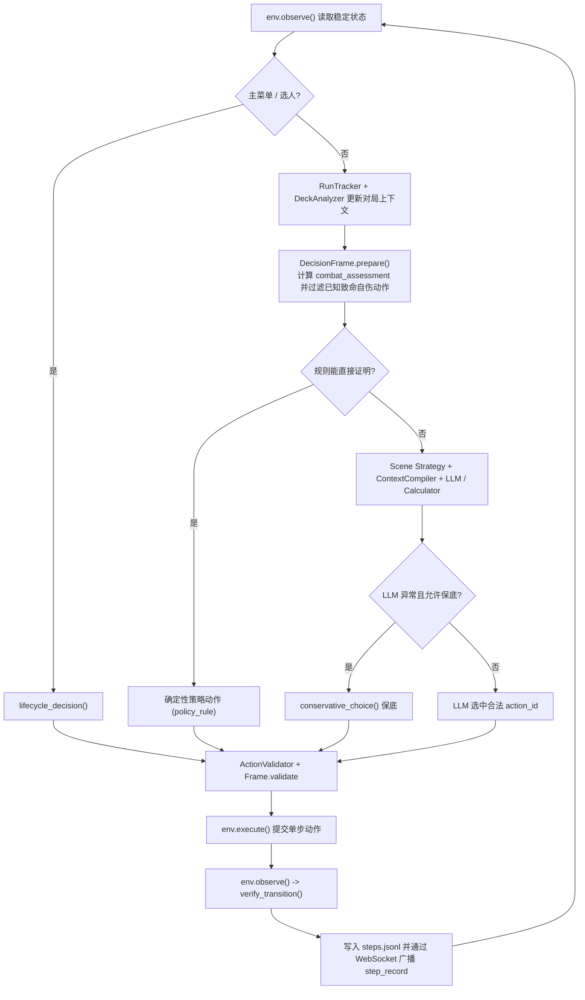

# SpireMind 架构设计 / Architecture

## 分层依赖 (Acyclic Package DAG)

`src/spiremind/` 采用严格的**单向无环依赖分层**（由 [tests/test_architecture_clean.py](../tests/test_architecture_clean.py) 自动检查）：

```text
config
  └─> domain
        ├─> knowledge
        ├─> bridge    (+ config)
        ├─> llm       (+ config)
        └─> storage   (+ config)
              └─> agent (+ config, knowledge, bridge, llm, storage)
                    └─> server (+ config, bridge, llm, storage)
                          └─> cli
```

| 模块 | 核心职责 |
| --- | --- |
| `config.py` | `Config` / `ModelConfig` / `GameConfig` / `RuntimeConfig` / `StrategyConfig` / `ServerConfig`，`PROVIDER_PRESETS`，`.env` 读写，API Key 掩码与脱敏配置导出，原子写回 `config.local.toml`。 |
| `domain/` | 不可变 `GameState` / `Action` / `ActionResult` / `Decision`、`Scene` / `ActionKind`、状态转移校验 `verify_transition`、场景归属路由 `owner_for`、运行时硬约束 `ActionValidator` / `ProgressGuard`。 |
| `knowledge/` | `EnemyKnowledge`（`enemies/v0.111.0.json`）、`StrategyLibrary`（`strategies/*/packages.yaml`）及语义版本匹配。 |
| `bridge/` | `normalize` 将 STS2AIMCP `/v2` 原始响应转为不可变 `GameState`；`MCPEnvironment` 管理 `/v2/decision/current`、`/v2/decision/wait`、`/v2/decision/act` 与可选待处理动作租约（pending journal）；`probe_bridge` 执行只读健康诊断。 |
| `llm/` | `OpenAIProvider`（兼容 Chat Completions，内置 `calculator.py` 确定性算术沙盒工具调用循环）与 `probe_llm`。 |
| `storage/` | `TraceWriter` 写入结构化 `manifest.json`、`steps.jsonl`、`progress.json`、`summary.json`；`TraceReader` 同时支持读取新版 `steps_v2` (`steps.jsonl`) 与旧版 `legacy_v1` (`states.jsonl` + `decisions.jsonl`)，校验 `attempt_id` 格式防止路径穿越并容忍尾部残行。 |
| `agent/` | `mechanics/`（`effects.py` 纯卡牌/遗物数值解析与即时效果核验，`planner.py` 有界生存/斩杀搜索与全量 `assess`）、`context.py`（牌组分析、路线视野、Token 预算 `ContextCompiler`、纯内存 `RunTracker`）、`policies.py`（`CombatStrategy` / `RunStrategy` / `MapStrategy` / `EventStrategy` + `DecisionFrame` 动作约束）、`session.py`（统一驱动 Web 与 CLI 的异步 `AgentSession`）。 |
| `server/` | FastAPI 工厂 `create_app`、`routes.py`（REST 控制、配置读取/保存、Doctor 诊断、历史轨迹查询）、`stream.py`（`/api/ws` 实时状态/决策事件推送）与 `web/dist/` 静态 SPA 托管。 |
| `cli.py` | 暴露 `ui`（默认）、`play`、`doctor` 三个子命令。 |

---

## 决策执行闭环 (`AgentSession`)



### 安全边界

1. **动作集合由游戏桥接锁定**：策略与模型只能返回 `state.legal_actions` 中已存在的 `action.id`，不能编造卡牌、目标或参数。
2. **未知不冒充已知**：当出现未建模的能力/卡牌效果或抽牌随机性时，确定性搜索会停止在安全边界内并将未知项保留在评估摘要中，不覆盖模型判断。
3. **单步推进与立即重观察**：即使搜索找到了多步斩杀/生存序列，每步也只执行第一个动作，在真实下一次状态到来后重新计算。

---

## 前后端通信与回放存储

- **端口分离**：游戏模组 bridge 默认监听 `127.0.0.1:8080`；SpireMind 后端监听 `127.0.0.1:8765`。开发模式 (`vite dev`) 通过 `web/vite.config.ts` 将 `/api` 与 `/api/ws` 代理到 `8765`；生产模式由 FastAPI 直接托管构建好的 `web/dist/`。
- **日志格式 (`runs/<attempt_id>/`)**：
  - `manifest.json`：创建时间、模式与脱敏后配置快照；
  - `steps.jsonl`：每行一条完整自包含步骤快照（`state`、`decision`、`combat_assessment`、`run_context`、`receipt`、`verify_ok`、`latency_ms`、token 统计）；
  - `progress.json` / `summary.json`：运行中状态与终局汇总。
