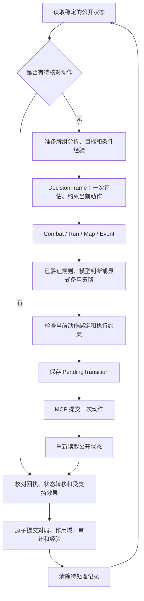

# SpireMind 当前架构

本次重构保留单进程、单游戏动作写入者和单 SQLite 工作线程。专业 Agent 负责各自场景的判断，运行器统一管理执行、恢复和记录。重构的目标是让决策依据、动作约束与学习证据能够分别检查；不以增加 Agent 数量或抽象层数代替规则覆盖。

## 模块职责

| 模块 | 负责 | 不负责 |
| --- | --- | --- |
| `core/` | 不可变游戏状态、动作、共享上下文、模型契约、对局目标、基本转移校验 | HTTP、SQLite、场景策略 |
| `decision/` | 场景路由、决策帧、上下文组织、牌组分析、规则与有限搜索 | 发送游戏动作、保存数据库 |
| `decision/mechanics/` | 公开数值解释、资源支付顺序、目标效果、保守的效果核验 | 推测隐藏抽牌顺序或未知机制 |
| `decision/planning/` | 输出、生存、路线及整局目标规划 | 把计划中的旧 action_id 留给下一次状态执行 |
| `application/` | 准备记忆、组织一次决策、管理待处理动作、原子提交、生命周期 | 自行发明游戏效果 |
| `adapters/` | MCP 游戏接口、通用模型接口、SQLite、日志、进程锁和控制文件 | 场景策略的选择 |
| `knowledge/` | 带版本的静态策略、技能和敌人知识 | 当前游戏状态的权威来源 |
| `learning/` | 经验检索、证据校验、条件经验及后台复盘 | 游戏操作、修改模型权重、声称动作最优 |
| `evaluation/` | 固定脚本契约检查、标注局面验收、性能与显式模型对照 | 把固定轨迹回放当成反事实胜率 |
| `bootstrap.py` / `cli.py` | 对象组装、资源关闭与命令调度 / 参数解析 | 维护另一套决策规则 |

`core` 不依赖决策、应用或适配器。`decision` 和 `learning` 不导入应用或适配器；学习中的战术校验复用纯机制函数。依赖边界由 `tests/test_architecture.py` 检查。卡牌数据库实现位于 `adapters/storage/cards.py`，决策代码只使用查询能力契约。

## 一次决策如何完成



1. 读取游戏提供的当前动作集合，路由与记忆所有权统一使用 `core/routing.py`。
2. `DecisionFrame` 对当前状态计算一次战斗评估，供规则、上下文和备用策略共享。在支持的版本和效果范围内，排除无法支付 HP 成本的动作。
3. 能证明有用的规则可以直接决定动作；其余由模型比较当前候选。模型只能返回合法 action_id，不能生成执行参数。仅有一个候选的分支也经过相同执行边界。
4. 发送前再次检查动作是否属于当前决策、目标是否完全一致，以及是否违反决策帧的约束。暂停后丢弃尚未执行的决策，重新观察。
5. 每次只提交一个动作。即使搜索给出多步路径，后续步骤也必须在新状态下重新规划，不能重放旧 action_id。

未知效果不会被自动判定为安全、致命或无解。搜索限制、版本范围和未知能力保留在评估结果中。

## “聪明”体现在哪里

- **先算确定部分。** HP 成本在治疗和能量收益之前支付；输出与生存搜索、即时效果核验共享这一资源转移函数。目标专属预览不会修改其他目标的数值缓存。
- **不因未知选项放弃已知解。** 未支持的其他手牌会阻止“完整搜索/最大伤害”的结论，但不会抹掉由受支持动作组成的已验证致胜路径。显式抽牌的后续状态保持未知，不按隐藏新牌推算完整序列。
- **区分可行与最优。** 规划结果分别表达可行性、搜索完整性、截断和限制；找到一条路径不等于比较了所有路径。当前截断搜索不会强制执行未完成证明的致胜或生存路径。
- **跨场景有共同目标。** `RunIntent` 保存当前 act、可见 Boss、牌组缺口、HP 储备、药水释放条件、证据和重新考虑条件。它会随新的分析重新生成。Combat、Run、Map、Event 的上下文都能读取这一目标。
- **用实际结果修正后续判断。** 保存近期战斗中观察到的失血、恢复、结束回合时剩余能量、药水使用和已核验动作数。剩余能量只是一条观察，不自动等同于浪费。药水使用也不冒称已经量出药水收益。
- **奖励和跳过有共同基准。** 为卡牌奖励提供加入该牌后的牌组缺口变化，与跳过的零变化比较。它是透明的密度启发式，不是强制选牌分数，也不取代对卡牌真实效果的判断。

旧的 `current_plan`、`assumptions`、`rejected_options` 和 `decision_context` 没有生产消费路径，已删除；`combat_tactics` 转发模块也已移除。保留的工作记忆只包含当前目标及计算同回合 HP 变化所需的状态。

## 执行成功不等于判断正确

日志分别记录：

| 字段 | 含义 |
| --- | --- |
| `execution_accepted` | 收到身份匹配的 completed 回执，并核对了下一状态 |
| `transition_verified` | 动作绑定、状态推进及对局/版本/角色约束成立 |
| `effect_verification.status` | 受支持的即时效果为 confirmed、conflict，或没有足够依据的 unknown |
| `semantic_success` | 保留的兼容字段：completed 转移且未发现已知效果冲突；**不代表完整效果或策略最优已获证明** |

即时效果核验只覆盖少量无额外遗物/能力干扰的基础卡牌及同回合状态。跨战斗结束、未知能力、抽牌等情况通常返回 unknown。冲突会进入日志，并阻止该转移作为成功策略更新或正面经验。

## 保存与重启

`MemoryManager` 在副本中计算新状态。对局、工作作用域、策略审计、交接和经验在同一事务中保存；提交成功后才发布到内存。失败不会使 policy_version、目标或工作记忆先行生效。

`committed_transitions` 对同一对局实例的转移去重，避免重试重复增加策略版本、关键决策或战斗统计。作用域删除也参与事务；结束战斗或对局后不会从数据库重新恢复已清除的工作状态。

存在两类持久记录，职责不同：

- `pending-<bridge>.json`：游戏适配器管理的传输租约，用于判断一个请求是否可能已被接受。
- `execution-<bridge>.json`：应用层保存的原状态、决定、回执和记忆版本，用于在重启后完成核验与提交。每个操作具有独立 ID，开局恢复不会重复创建对局实例。

记录在提交游戏动作前落盘。进程停止后，优先核对上次动作；缺失回执保持 uncertain，不将其升级为已证明的成功效果。稳定旧租约的非接受判断依赖现有 MCP v2 协议。损坏的应用记录会停止恢复，不能作为发送新动作的理由。

Mock 不保存真实游戏状态，因此启动新的 Mock 进程仍从固定脚本开头开始，不使用实机的持久恢复日志。

## 经验学习

三个独立训练 seed、冻结留出集、版本条件和反例停用约束继续保留。重复效果观察不升级为“该策略比其他策略好”的结论。

检索缓存使用完整公开状态的指纹，避免手牌数值、合法动作或敌方能力改变后重用不适用的技能。后台复盘按当前作业最多 30 条证据所涉及的签名整理；战术学习按相关版本/角色范围处理，不为每个作业重新整理全部普通经验。相同内容和状态不会重复增加经验版本。

复盘仍共享 SQLite 工作线程。按条件缩小整理范围不等于建立了硬实时调度保证；大型历史库的队列延迟仍需单独测量。

## 配置与兼容

当前两份安装模板以及本机配置使用：

```toml
[model]
base_url = "https://api.deepseek.com"
model = "deepseek-flash"
api_key_env = "deepseek_api_key"

[model.extra_body]
thinking = { type = "disabled" }
```

真实密钥只从环境或本地 `.env` 读取，不写入 TOML、日志或版本库。配置切换不撤销服务商后台的旧密钥。[DeepSeek 接口说明](https://api-docs.deepseek.com/)是接口配置的官方参考；本轮未发真实请求验证账户权限或模型响应。

SQLite 增加转移去重表，`user_version` 为 4；旧对局数据的新增字段有默认值，旧工作作用域中的已删除字段会被忽略。没有删除或重建现有用户数据库。对局记忆的 JSON 快照保留既有格式；历史审阅和历史实验报告描述其各自版本。

内部 Python 模块路径已调整，仓库源码、测试和脚本同步迁移。仓库外直接导入旧 `spiremind.runtime`、`memory`、`strategies` 等模块的脚本需要更新；没有为旧内部路径保留大量转发层。CLI 命令入口保留，新增 `evaluate`。

## 离线验收与实际边界

```powershell
.\.venv\Scripts\python.exe -m pytest -q
.\.venv\Scripts\python.exe -m ruff check src tests scripts
.\.venv\Scripts\python.exe -m ruff format --check src tests scripts
.\spiremind.cmd evaluate --output runs/quality/latest.json
.\spiremind.cmd benchmark --rounds 3 --output runs/benchmarks/refactor.json
```

pytest 禁止真实 HTTP；模型接口测试仅使用模拟传输。`evaluate` 使用 8 个独立标注的局面，覆盖 HP 成本、致胜、格挡生存、多敌人优先目标、未知选项、能量解锁、未知能力及无法避免的结束回合。报告记录源码与数据哈希、选择结果和排除原因，模型调用数为 0。

`benchmark` 测量上下文准备、查询和日志等开销；只有显式 `--use-model` 才发起模型对照。原来的固定十动作 Mock 用于验证整条程序链，不用于衡量策略质量。

目前仍有明确边界：完整输出搜索主要面向单敌人和已支持机制；有限局面验收不能证明全部角色、版本或完整对局的胜率提升。跨目标完整搜索、更多效果覆盖以及整局策略的对照实验，应在这套可检查边界内逐步扩展。本轮验收不调用模型或游戏 API，不给出实战提升结论。
