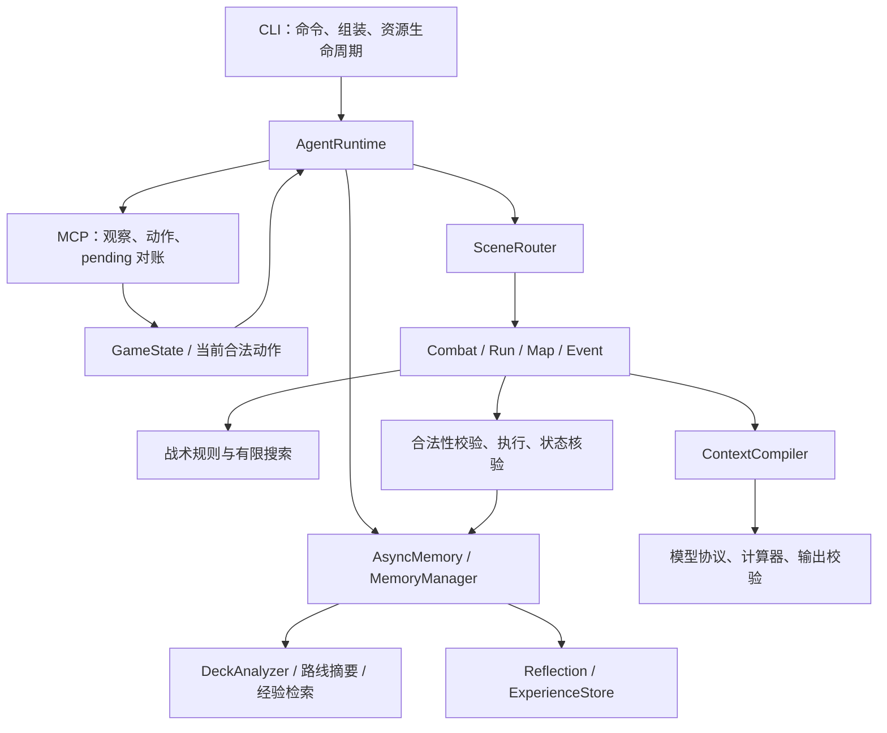
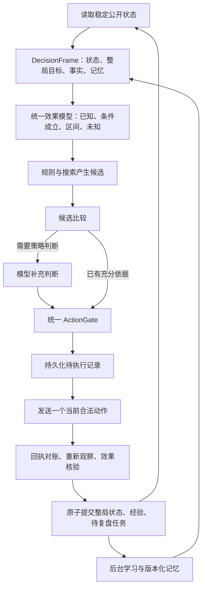

# SpireMind 架构审阅与重构提案

日期：2026-10-30。状态：设计提案，尚未实施业务代码重构。

审阅基线：`3df27e546764fc571fee14569b73408b10748044`。源码与随包知识指纹：`784a13c56414c9e3d372cc93be5248ded2dacec634ac24936be87b0eac0df817`。本文源码行号对应此基线。

## 1. 判断与审阅范围

建议采用**模块化单体 + 统一决策流水线 + 共享效果模型 + 可恢复执行 + 独立评测**。保留 Combat / Run / Map / Event 的专业分工，让它们作为同一决策协议下的策略模块；继续由唯一执行者操作游戏。

主要改进机会在三处：决策的安全约束没有覆盖所有出口；游戏机制与策略判断混在多个位置；经验和评测还不能充分回答“换一个决策是否更好”。增加专业角色数量本身不能解决这些问题。

覆盖范围：

- `src/spiremind` 的全部 62 个 Python 模块，共 9,596 行（包含空行），梳理入口、依赖和数据流，重点逐段检查运行、决策、效果计算、记忆、模型调用和评测链路。
- `tests` 的 16 个 Python 文件、公开状态数据与回归 fixture；运行现有完整测试集。
- 5 个 Python 辅助脚本、安装与桥接脚本、C# 探查入口、桥接补丁、配置、打包与 CI；检查知识数据的版本和消费方式。
- 既有架构、鲁棒性和记忆文档作为背景，与当前实现交叉核对。第三方 `references/` 与游戏本体不属于本次逐模块代码审阅范围；敌人知识库没有逐条核对外部游戏机制。

验证结果：

| 检查 | 结果 | 能说明什么 |
| --- | --- | --- |
| Ruff 检查、格式检查 | 通过；84 个文件格式符合要求 | 当前基础规范成立 |
| 完整 pytest | **221 passed，15.70 秒** | 现有回归通过，不代表没有未覆盖缺陷 |
| 隔离行为探针 | 复现下文 F1、F2、F9；验证 F3 的当前边界 | 使用临时数据库和假模型，无真实游戏动作 |
| 公开评测集的当前战斗评估 | 16 个 case 中有 6 个战斗 case，6 个的 `visible_damage_plan_known` 均为 false | 这些固定局面的整回合攻击搜索覆盖有限；不代表总体覆盖率 |

最初受限环境的临时目录与 Windows 异步事件循环无法正常工作；定位到事件循环创建本地通信通道时阻塞后，在普通执行环境完成测试。没有调用付费模型，没有启动实机对局，也没有运行会安装软件或覆盖游戏模组的脚本。

## 2. 当前架构与值得保留的部分

当前主流程：



已经具备且应继续保留：不可变公开状态、动作绑定当前 decision、只提交已有 action ID、单写入者、发送前持久化 pending、独立恢复预算、取消恢复、有界日志队列、SQLite 线程所有权、知识版本校验、按 seed 隔离训练与留出数据、经验反例停用，以及不读取隐藏抽牌顺序的约束。

现有运行方式是“每个状态路由一个专业决策者”，不是四个角色同时竞争游戏控制权。这种安排适合顺序变化的游戏环境。

## 3. 主要发现

### F1 · P1：执行入口缺少统一的决策安全检查

位置：`strategies/combat.py:127`、`strategies/base.py:29`、`runtime/validator.py:8`、`runtime/agent.py:322`。

Combat 会先尝试强制规则，再交给模型；模型结果返回后，最终校验只检查终局限制、decision ID 和合法动作成员关系。提示词中的 `Never choose self_lethal` 没有对应的执行后置约束。Provider 要求数值 forecast 与当前事实相符，也不能保证选的是合理动作。

隔离复现：角色 2 HP，合法的 Bloodletting 明确消耗 3 HP，同时存在结束回合且仍保留 2 HP 的选择。`assess()` 标记 `self_lethal=true`，假模型返回这张牌及正确 forecast，`CombatStrategy.decide()` 与最终 `ActionValidator` 仍然接受。这里只证明当前代码会接受这种模型输出，不声称真实模型已经在该局面犯错。

**改造要求：**规则、搜索、模型、rules 模式都必须经过同一个 `ActionGate`。可以证明的立即死亡等硬约束必须由代码检查；未知机制不能凭空判定为安全，也不能直接当成确定死亡。禁止项需要记录证据、作用范围和例外条件。

### F2 · P1：数据库事务回滚不能恢复已经修改的内存状态

位置：`memory/manager.py:324`，尤其 `:368` 与 `:462`；`memory/storage_sqlite.py:47`。

`update_sync()` 先修改 `self.run`、策略版本与 Working，再调用数据库事务。存储层确实在提交后才发布自身缓存；但业务对象已经被改动，异常时没有恢复。

隔离复现：让 `memory_audit` 插入触发 SQLite 错误。失败后数据库仍为原 gold policy、version 0，内存已为新 policy、version 1；随后调用 `context()`，这个失败事务中的策略被保存进数据库。已有事务回归检查的是存储缓存，没有覆盖这一层业务状态。

**改造要求：**根据旧快照计算新的 `TransitionCommit`，在一个事务中保存 Run、Working、策略审计、Episode、交接和学习任务；成功后才替换内存对象。对同一 transition 重试应幂等。

### F3 · P2：状态推进、动作效果一致、策略优劣需要分开表达

位置：`runtime/verifier.py:5`、`runtime/agent.py:137`、`memory/experience.py:141`。

当前 `verify_transition()` 检查动作属于旧状态、decision 改变、revision 增加。Runtime 另外核对回执身份、完成状态和 next decision，这些检查有价值；但 `semantic_success` 最终由这些检查加 `completed` 得出，没有比较预测效果与实际效果。

独立调用 verifier 时，仅换成另一个 run ID、增加 revision 与 decision ID，它仍返回 true。这是验证边界的探针，不是已观察到的跨局错误执行。新 verifier 应区分普通动作的同局要求与 EMBARK 等允许换局的生命周期动作。

**改造要求：**分别保存 `dispatch_status`、`transition_verification`、`effect_verification`；效果采用 `consistent / contradicted / unknown / not_applicable`。策略质量单独由评测标签或对照实验判断。未知随机抽牌等部分无法核验时，只核验已知部分，不伪造整段效果证明。

### F4 · P2：模块名称分开了，职责和依赖仍在交叉

代表性位置：`cli.py:86`、`runtime/agent.py:39`、`memory/manager.py:72`、`memory/async_store.py:9`、`strategies/base.py:1`。

- `cli.execute()` 同时处理命令分派、对象组装、知识同步、锁、预算、后台复盘和资源清理。
- `AgentRuntime` 同时负责阶段控制、恢复、策略调用、执行、记忆更新、日志结构和 Provider 指标汇总，并兼容同步/异步两套记忆形状。
- `MemoryManager` 除了存储状态，还决定角色归属、校验自然语言策略、推导路线、制作学习证据和交接包；角色归属与 `SceneRouter` 重复。
- 存储包装器导入 `DeckAnalyzer` 和运行日志指纹；策略直接捕获具体 OpenAI provider 的异常；环境导入 runtime 校验器；战斗评估又导入 context 中的数值事实构造。

这些是包之间的双向职责依赖，不等于每条路径都会触发 Python 循环导入错误。维护风险在于：新增一个规则、角色或存储实现，会要求修改多个互相了解内部结构的模块。

**改造要求：**统一数据契约和能力接口；业务计算不认识 SQLite、HTTP 和提示词格式；组装只集中在一个入口；角色归属只保留一个 registry。

### F5 · P2：长期策略缺少可执行约束与战斗反馈

位置：`memory/run.py:6`、`strategies/run.py:100`、`memory/working.py:6`、`memory/manager.py:171`。

Boss 计划、药水与金币策略主要是字符串；牌组分析主要使用角色密度、关键词和固定权重。它们是有价值的启发式，但无法直接验证“留这瓶药是为了哪一场威胁”“这张牌是否改善了启动速度”。Map、Run、Combat 之间目前更多是共享文字和资源摘要。

`current_plan` 定义为旧 `Action` 列表，生产源码中没有建立或消费它的路径，主要在 revision 改变时清空；现有短序列搜索每次从当前状态重算。重新观察是正确的，但跨决策的战术意图并未成为独立对象。

**改造要求：**使用结构化 `RunIntent`，保存目标威胁、资源预留条件、牌组缺口、依据和有效期。记录战斗实际失血、启动回合、费用拥堵和药水收益，供下一次 Run 决策使用。短计划保存意图和前提，每一步重新绑定当前合法动作。

### F6 · P2：战斗效果解释与搜索需要一个共同基础

位置：`strategies/tactics/assessment.py:30`、`effects.py:266`、`search.py:29` 与 `:390`、`context/action_facts.py:6`。

单动作评估、生存搜索、攻击搜索、模型 forecast 各自组织部分数值逻辑。攻击搜索限于单个存活敌人，遇到不支持的效果会整体放弃完整搜索；生存搜索和攻击搜索又维护不同的状态转移表示。当前对未知机制和 4,096 次转移上限的保守处理应保留。

本次对随包公开集重新评估：6 个战斗样本均未得到完整攻击规划，其中两个还因未支持的玩家能力跳过生存搜索。说明扩充“可验证机制覆盖”比单纯添加更多提示文字更值得投入。这组历史局面不是随机样本，不能据此推断实战占比。

**改造要求：**抽出统一效果模型和受支持范围内的 `transition(state, action)`；生存、输出和资源目标使用同一转移实现。分别表达“某条已找到路径可行”“搜索是否完成”“是否证明最优”。若搜索被截断，已验证路径可以作为有条件候选，不能称为最优或据此宣布无解。

### F7 · P2：学习已有证据门控，但贡献与运行成本应独立评估

位置：`memory/experience.py:305`、`:384`、`:439`、`memory/reflection.py:37`、`memory/tactics.py:50`、`strategies/combat.py:145`。

目前的证据校验、三个独立训练 seed、留出隔离和反例停用应保留。但“多个 seed 观察到同样的 Block 增量”证明的是条件效果，不证明选择该动作优于其他动作。`rage_before_attack` 在没有 active 学习经验时也有静态强制规则；启用学习后执行同一动作，不能直接归因于学习提高质量。

后台复盘虽然是异步任务，但离线 consolidate 与前台 prepare 共用一个 SQLite 执行器；它会遍历训练证据，部分 proposal 验证再扫描对应场景数据。大数据量下可能延长前台排队，这里没有测出其当前延迟，不能把它写成已证实的性能瓶颈。

检索缓存还混合了候选召回和适用性过滤：key 没有包括所有合法动作、卡牌动态值与敌方能力，而后续部分筛选依赖这些字段。应缓存稳定候选，每次对当前状态重新检查适用条件，或显式维护完整依赖指纹。

**改造要求：**效果观察、战术先验、策略改进证据分类型保存；学习功能单独消融。复盘采用有游标的增量作业、有限批次和前台优先调度；只有量测证明必要时才增加独立只读快照/计算进程，数据库提交仍由一个写入者完成。

### F8 · P2：评测没有形成决策质量的完整验收链

位置：`environment/mock.py:22`、`benchmark.py:109`、`bench_worker.py:34`、`scripts/evaluate_combat.py:36`。

Mock 每次接受合法动作后推进固定脚本，本身明确声明不是游戏模拟器。现有 benchmark 主要测准备时间、查询数、token 与合法性；模型对照固定一个模型和四个局面。脚本可以比较旧、新动作，但没有为每个候选提供独立的质量判据。现在能较好地证明“跑得通、输入更短”，还不能证明“整局策略更强”。

只读汇总本地已有 summary：35 条 live 记录中，13 条为 error_limit、13 条为 death，其余为中断或预算/步数限制。它们跨版本、包含续局，并不是 35 个独立完整实验，因此不能据此计算当前胜率或归因模块优劣。

**改造要求：**把评测提升为独立模块，区分契约、效果一致性、局部决策质量和完整对局结果；固定数据、模型设置、知识与记忆快照。回放同一历史轨迹不能当成换动作后的反事实胜率。

### F9 · P2：真实运行的状态展示依赖了错误的目录关系

位置：`cli.py:58`、`:187`、`:220`、`runtime/control.py:55`。

Live 控制文件跟随临时目录中的 bridge lock，trace 写入配置的 runs 目录。`control_status()` 却从控制文件父目录下寻找 `attempt/progress.json`。隔离构造这两种目录后，可以得到 `active=true`、真实 progress 文件存在，但返回的 progress 为空。现有测试将两者放在同一个父目录，未覆盖真实布局。

**改造要求：**让统一 `SessionDescriptor` 明确记录运行 ID、控制路径和 trace 路径，status 通过受约束的路径解析读取；不能从某个文件的父目录推测另一个子系统的位置。

## 4. 目标结构

维持一个 Python 应用、一个游戏动作写入者、一个数据库写入者。以下是逐步迁移后的职责布局，不要求一次性创建全部目录。

```text
spiremind/
  core/                     # 不可变状态、动作、证据类型、能力接口
    state.py / actions.py
    decision.py / evidence.py / ports.py
  application/              # 用例与生命周期编排
    session.py              # 暂停、恢复、期限、停止与状态
    decision_cycle.py       # 决策阶段编排
    execution.py            # journal、单次发送、对账、提交
    run_state.py            # Run/Working 的纯状态更新与权限
  decision/                 # 游戏决策逻辑
    mechanics/              # 版本化效果规则、支持范围、转移
    planning/               # 共用转移的搜索与候选评价
    policies/               # combat、run、map、event、lifecycle
    safety.py               # 所有来源共用的最终 ActionGate
    context.py              # 从 DecisionFrame 生成模型视图
  adapters/                 # 具体外部实现
    game/                   # MCP HTTP、公开状态转换、协议能力
    model/                  # HTTP、工具消息、输出解析、用量
    storage/                # SQLite repository、事务与迁移
    telemetry/              # trace、进度投影、指标
    cli/                    # 参数解析与结果展示
  learning/                 # 证据摄入、检索、复盘、晋升/停用
  evaluation/               # 数据集、回放、独立评分、消融、整局统计
  knowledge/                # 既有版本化数据资产
  bootstrap.py              # 唯一的对象组装入口
```

依赖约束：`core` 不依赖上层；`decision` 与 `learning` 通过 core 中的类型/接口交换数据，不能导入对方的策略实现；`application` 调用决策和学习用例，通过 ports 访问外部系统；`adapters` 实现 ports；`bootstrap` 选择具体实现。知识读取通过能力接口注入，核心规则测试不需要数据库。用自动 import 检查约束方向，并先为 core 与 ports 建立静态类型检查。

保留现有 `combat_tactics.py` 等兼容入口一段时间。模块移动与算法变化分开提交，每次提取一个实际职责，避免出现大量只有一行转发的抽象层。

## 5. 一次决策如何工作



关键契约：

| 对象 | 主要内容 | 解决的问题 |
| --- | --- | --- |
| `DecisionFrame` | run instance、decision/revision、策略版本、知识/规则版本、当前状态、事实与记忆快照 | 每项结论绑定同一个观察时刻 |
| `EffectAssessment` | 数值、来源、前提、适用版本、未知原因、支持的效果范围 | 不再混用实时值、推导值和启发式 |
| `ActionProposal` | 当前 action ID、来源、依据、预测、资源代价、可选短计划 | 规则与模型使用相同出口 |
| `RuleVerdict` | 允许/拒绝/不确定、规则 ID、依据、有效范围 | 把硬约束与策略偏好分开 |
| `PlanCandidate` | 战术目标、下一步语义、前提、预测、feasible/complete/optimal 标记 | 不把未完成搜索当成无解，也不复用过期 action ID |
| `RunIntent` | 目标威胁、构筑缺口、资源预留及释放条件、有效期、证据、版本 | 长期策略可被 Combat/Map 消费和验证 |
| `TransitionRecord` | 前后快照、动作/回执、执行状态、分层核验、策略更新、实例身份 | 让恢复、回放和学习共享同一证据 |

### 5.1 安全约束与策略比较

硬约束限定为有充分证据的事项：动作是否属于当前决策、目标和资源是否有效、明确 HP 成本是否造成不可逆的立即死亡，以及已验证机制下的其他禁止项。硬约束同样适用于单一合法动作的快捷分支和 rules 模式；确实只有损失动作时应给出明确的“被迫结果”记录，不能伪装成安全选择。

其余收益使用多维评价：已知生存结果、伤害/控制、剩余能量、药水与金币消耗、构筑目标、未知影响范围。开始时使用透明规则与 Pareto 候选，不先构造未经标定的“胜率分数”。模型选择候选或提出另一个合法动作后，仍须经过相同效果评价与 ActionGate。

Adapter 应保留完整的公开、可执行动作集合；参数未绑定、调试动作等协议限制在 adapter 处理。是否优先检查奖励、暂不丢药水等策略筛选移到候选策略，并记录被过滤的理由。两者不能都隐含在 `legal_actions` 里。

### 5.2 统一效果模型与渐进规划

先把现有经过测试的机制原样提取为小型 Python 规则注册表，按照版本、卡牌/能力/遗物和公开前提匹配。每条规则返回效果和支持范围，保留实时数值高于静态知识的优先级，不实现任意脚本式规则语言。

生存搜索、伤害搜索和解释给模型的数值共同使用这套效果。未知机制不统一降成 0：能证明某个局部事实时保留该事实，无法界定影响的分支仍然停止精确外推。先扩充实战日志中高频且有公开证据的机制，再扩展多敌人、控制和资源顺序。

执行仍然是**规划一段，只走一步，再观察**。遇到抽牌、选牌弹窗、随机目标、未知触发或外部操作时立即失效重算。可以保留“先建立格挡，再用格挡伤害牌”的意图；下一张牌的 action ID 必须从新快照中选择。暂不要求实现完整游戏模拟器或深层随机搜索。

### 5.3 长期策略更新频率

Run 在奖励、商店、休息、战斗结束和 Boss 信息改变时更新 `RunIntent`；Combat 在自己的回合内优化行动，返回实际表现；Map 消费当前构筑与资源约束。每打一张牌不必触发一次整局规划或额外模型调用。

例如“保留药水”应包含要处理的威胁和提前使用条件；“补防御”应说明当前缺的是启动前生存、每回合稳定防御还是抽牌可达性。未知指标明确保留未知。先让这些约束可追溯，再用实验调整阈值和权重。

## 6. 执行、持久化与模型边界

### 6.1 一个显式执行状态机

建议状态为 `observed → proposed → prepared → dispatch_attempted → receipt_observed → reconciled → committed`。明确哪些状态可以恢复、哪些错误可重试。桥接超时或回执不明时先对账，不重新发送未经确认的变更。

现有桥接 journal 保存动作身份，Runtime 的完整 pending transition 又在内存。新 journal 应包含恢复所需的前状态引用、候选/策略版本、已收到的回执和提交状态；执行记录先持久化，再发送。收到后状态时先持久化关联，最后完成业务提交。进程崩溃后能知道“还有一个动作需要核验/提交”，而不只知道有一个旧 action ID。

外部游戏动作和 SQLite 之间没有分布式事务，不能承诺真正 exactly-once。目标是保留证据、避免不明情况下重复发送，并让本地提交按 transition ID 幂等。桥接 lease/decision 行为是实现前提，迁移时必须继续用契约测试验证。

### 6.2 内存发布与持久化同生共死

Run/Working 的更新采用纯函数或副本构造；事务成功才发布。策略版本更新使用原子 compare-and-set；任何失败都留下原状态。后台通知作为同一事务中的 outbox 行保存，独立投递，消费者按作业 ID 去重。

SQLite 保持单写入者和 WAL。后台任务按有限批次处理，记录游标、状态和重试原因。新增数据结构采用版本迁移：备份并验证，兼容读取旧 schema，旧记录缺乏效果证明时保留未知；不能把旧 `semantic_success` 批量提升为新意义的效果正确。

### 6.3 模型会话与传输分开

HTTP adapter 负责请求、响应、错误分类和逐请求用量；模型会话负责有限工具往返、输出解析与修复；应用层负责总预算和时间期限。策略只拿 `ActionProposal` 和标准化失败原因，不读取 provider 的几十个可变计数器。

把鉴权/配置错误、输入过大、无效模型输出和临时网络错误分开：输入过大应先触发上下文重编译；不可重试配置错误应清晰退出；临时失败遵守统一恢复策略。保留当前“模型失败时先恢复，不直接把保守 fallback 当成正常模型动作执行”的默认行为。

## 7. 学习与评测闭环

学习对象分为三类：

1. **效果观察**：在特定条件下 Block/HP/牌数如何改变，要求可核验的前后事实。
2. **战术先验**：某种顺序在明确前提下可行或有局部优势，使用前重新检查。
3. **策略改进证据**：选牌、路线或资源策略带来更好结果，需要独立对照，不能由执行成功或三次同值观察自动推导。

经验始终低于当前公开事实和已验证机制。保留版本/角色/seed 分组与训练/留出隔离；测试集不得用于调权重、晋升经验或规则调优。已使用过的公开回归集适合做开发验收，不能再称作未见过的最终测试集。

评测按以下层次组织：

| 层次 | 验收内容 | 证据来源 |
| --- | --- | --- |
| 契约与恢复 | 旧动作拒绝、不明回执不重发、暂停恢复、事务原子性、路径正确 | 原有测试 + 本次缺口回归 + 故障注入 |
| 效果正确性 | 支持机制预测与实际公开结果一致，未知不产生确定证明 | 捕获的桥接前后状态、人工核验的小例子 |
| 局部决策质量 | 自杀动作、漏斩杀、已知可生存却失败、无收益药水使用、牌序损失 | 独立标注的可接受动作集合、已知小状态的穷举判据 |
| 端到端质量 | 完整对局胜负、到达楼层、错误退出、每场失血、资源使用 | 冻结版本后的独立 seed 对局 |
| 成本 | 每个已完成决策的请求/token、P50/P95 延迟、队列等待、搜索节点 | 同一配置的事件与请求记录 |

评分不能只复用被测 planner 自己的结果，否则相同错误会同时出现在决策与裁判中。历史状态回放只比较这个观察点的决策；动作改变后，不把原轨迹的后续状态当作新动作的模拟结果。

建议消融顺序为“现有系统 → 可靠性修复 → 共享机制与规划 → 结构化整局策略 → 加入学习”，每次只改变一类因素。完整局比较尽量使用匹配 seed、相同角色/进阶、相同模型配置和冻结记忆；独立 seed 是统计单位，续局不是新样本。先小规模估计方差，再确定样本量，报告置信区间与失败类型。模型费用预算单独设定，不能由这份设计推定已授权付费实验。

## 8. 迁移顺序与退出条件

| 阶段 | 交付 | 必须满足的退出条件 |
| --- | --- | --- |
| S0：冻结基线 | 冻结回归集、评测配置、源码/知识/记忆指纹；把本次探针转为正式缺陷回归 | 可重复得到原基线；新增测试先证明缺口 |
| S1：修复执行边界 | ActionGate、内存提交原子性、分层核验、SessionDescriptor | 本次复现问题消失；221 项旧测试保持通过；不明动作不重复发送 |
| S2：提取职责 | core 契约、统一 router、bootstrap、session/execution、repository ports | 旧/新链路在冻结状态上行为一致；依赖方向检查通过 |
| S3：统一战斗基础 | 共用效果模型和转移；合并重复数值逻辑；增加有证据的机制覆盖 | 已支持机制无回归；未知分支明确；局部质量指标改善或至少不退化 |
| S4：整局策略协作 | RunIntent、战斗反馈、资源预留与释放、牌组边际价值 | reward/shop/map/combat 的联合场景可验证；新策略单独消融 |
| S5：学习与整局评测 | 增量学习、严格适用性复核、冻结学习快照、完整局实验 | 无留出污染；学习的净增益与成本有独立证据 |

S1 的安全与事务修复应该拆成小提交，不必等待目录迁移；S2 以结构变化为主，S3 之后才系统改变策略。每个切片保留旧策略入口用于离线对照，但同一实际游戏只启用一个执行者。上线前再跑打包、隔离 wheel 与安装验证，确认资源文件路径没有因目录迁移失效。

第一批最具体的工作建议：

- PR 1：模型/规则/单动作快捷路径共用最终检查，覆盖 2 HP/3 HP 成本的反例和未知机制边界。
- PR 2：Run/Working 副本更新、事务成功后发布、提交幂等；覆盖审计/Episode 写入失败与重试。
- PR 3：统一 SessionDescriptor 和核验类型；补独立控制目录、跨局普通动作、生命周期换局的测试。
- PR 4：提取 `DecisionFrame` 与 `EffectAssessment`，让现有评估、搜索、context 使用同一份结果，先保持决策行为不变。

## 9. 预计收益与尚未证明的部分

| 变化 | 预计收益 | 当前证据强度 |
| --- | --- | --- |
| 最终 ActionGate | 阻止已经识别出的错误动作穿过执行入口 | 入口缺口已复现；新实现尚未完成 |
| 事务内构造、提交后发布 | 避免失败写入污染后续策略和学习 | 污染路径已复现 |
| 共享效果模型 | 减少数值解释分歧，降低每增加一个机制的修改范围 | 代码依赖与重复状态转移已确认 |
| 更完整的短程规划 | 改善牌序、多敌人与资源组合判断 | 需新增机制证据与局部质量对照 |
| 结构化整局策略 | 减少选牌、路线、药水之间的不一致 | 架构假设，需联合场景和整局实验 |
| 学习分层与增量调度 | 更清楚地验证经验价值，控制后台工作成本 | 尚无新消融结果与规模压测 |

本提案不承诺胜率提升百分比。最有把握的近期结果是补齐执行和状态一致性缺口；游戏表现的提升应由机制覆盖、局部决策质量和独立完整对局逐层证明。
